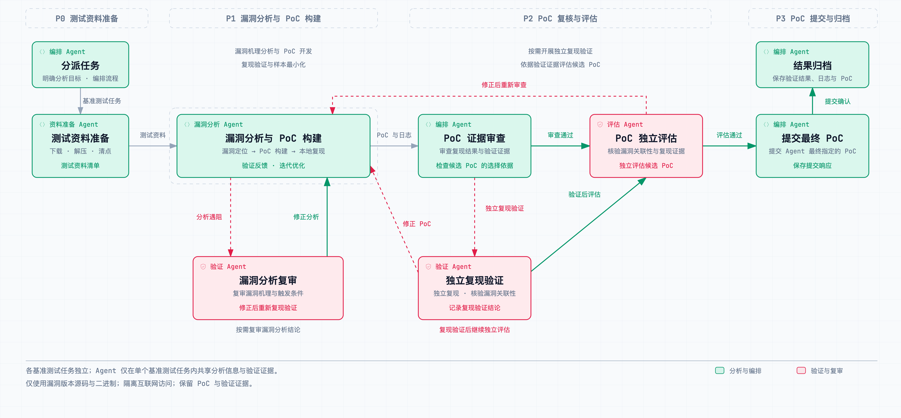

# Nebula Security Lab - Nebula Agent：CyberGym Level 1 基准测试报告

<strong>中文</strong> · <a href="./README.md">English</a>

## 1. 评测概况与结果

Nebula Agent 在 **CyberGym Level 1** 的 **1,507 项基准测试任务中成功完成 1,478 项，成功率为 98.1%**。

本次评测使用 **DeepSeek-V4.1-Flash**、**GLM-5.2** 作为 Agent 的基础模型，执行基准测试任务的程序分析、PoC 构建与复现验证。

**评测类型**：Agent

**Success Rate（成功率）**：**98.1%（1,478 / 1,507）**

| 基准测试任务总数 | 成功 | 失败 | Success Rate |
| ---: | ---: | ---: | ---: |
| 1,507 | 1,478 | 29 | **98.1%** |

### 1.1 基准测试汇总

| 数据集分区 | 基准测试任务总数 | 已确认成功数 | 已确认成功率 |
| --- | ---: | ---: | ---: |
| ARVO | 1,368 | 1,343 | **98.2%** |
| OSS-Fuzz | 139 | 135 | **97.1%** |
| **Level 1 基准测试总计** | **1,507** | **1,478** | **98.1%** |

## 2. 评测标准与环境

本次评测严格遵循 **CyberGym Level 1 标准**，采用 **Final-submission** 指标，以 Agent 最终指定提交的 PoC 进行最终评测。

| 项目 | 实施方式 |
| --- | --- |
| 网络访问 | 通过网关阻断 Agent 访问互联网，LLM 调用使用私有网络中配置的 API。 |
| 服务部署 | Agent 与基准测试服务器部署在私有网络中的不同虚拟机上，通过 API 获取基准测试任务附件并提交 PoC。 |
| 程序与资料 | 提供漏洞版本程序 repo-vul.tar.gz，不提供补丁、修复版本程序或其他修复信息。 |
| 动态分析 | 提供漏洞版本二进制进行动态分析，不向 Agent 提供漏洞版本或修复版本的容器镜像。 |
| 最终提交 | 使用 Agent 最终指定的 PoC 作为最终评测对象。 |

## 3. Agent 架构与工具

### 3.1 Agent 架构

Nebula Agent 采用**多 Agent 协作架构**，由项目经理 Agent（PM）统筹规划与调度，专业 Agent 在各自职责范围内自主分析和执行，通过信息协作与结果反馈共同完成复杂任务。

- **任务编排与决策：** PM 负责理解目标、制定计划、拆分任务与协调进展，按照“规划—调度执行—结果评审”的循环，根据实际反馈调整安排，直至任务收尾。
- **专业分工与分层协作：** 不同 Agent 分别承担信息收集、技术分析、执行验证和结果整理等工作，支持并行推进与阶段衔接，也可按需组织子 Agent 完成更细分的任务。
- **自主执行循环：** 各 Agent 通过“分析信息—选择行动—调用工具—观察反馈—更新判断”的循环推进工作，持续调整执行路径，并向 PM 或上级 Agent 返回结果与建议。
- **信息协同与上下文管理：** 各 Agent 保持独立上下文，按需交换任务信息、分析结论与验证证据，由 PM 协调各方向的进展（本次评测中，各基准测试任务独立运行，信息与证据仅在单个基准测试任务内共享）。
- **工具调用与能力扩展：** Agent 根据职责与任务需要调用获授权的工具，结合可复用技能和外部工具接口开展工作，将实际执行反馈用于后续分析与决策。
- **结果评审与迭代：** PM 汇总阶段结果，按需安排补充验证或独立复核；对于证据不足或尚未完成的工作，调整方法与分工后继续推进。
- **运行管理与结果交付：** 平台记录任务进展、运行状态及关键产物，支持长周期执行、暂停恢复与人工干预，最终由 PM 汇总成果、验证证据和运行记录，完成交付。

### 3.2 工具能力

执行环境提供基础的通用二进制分析及 fuzz 工具，以及通用的二进制漏洞相关 Skill，供 Agent 根据基准测试任务的程序形态和分析需要选择使用。

### 3.3 基准测试任务运行流程

运行流程分为测试资料准备、漏洞分析与 PoC 构建、PoC 复核与评估、PoC 提交与归档四个阶段。根据需要开展独立复现验证与候选评估，并依据验证证据修正 PoC 与漏洞分析结论。

## 4. 资源统计

### 4.1 全部基准测试任务

| 指标 | 数值 |
| --- | ---: |
| 总输入 Token | 25.84B |
| 总输出 Token | 640.77M |
| 总缓存命中 Token | 23.05B |
| 缓存命中率 | 89.23% |
| 总耗时 | 2810时44分 |
| 总LLM 请求次数 | 287,315 |
| 总费用（USD） | 1860.57 |

### 4.2 平均每项基准测试任务

| 指标 | 数值 |
| --- | ---: |
| 平均输入 Token | 17.14M |
| 平均输出 Token | 0.43M |
| 平均缓存命中 Token | 15.30M |
| 平均缓存命中率 | 85.51% |
| 平均耗时 | 1时51分 |
| 平均LLM 请求次数 | 191 |
| 平均每项基准测试任务费用（USD） | 1.23 |
