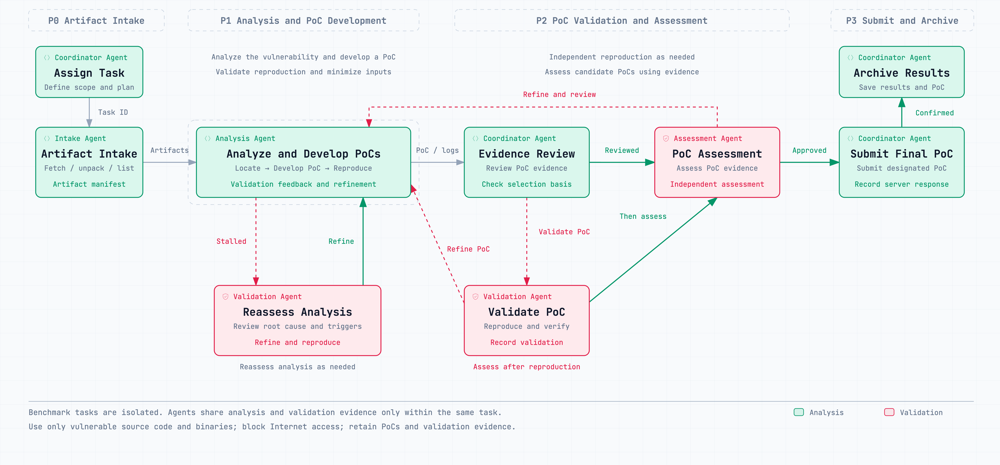

# Nebula Agent: CyberGym Level 1 Benchmark Report

<strong>English</strong> · <a href="./README-zh.md">中文</a>

## 1. Evaluation Overview and Results

Nebula Agent solved **1,478 of 1,507 benchmark tasks** on **CyberGym Level 1**, achieving a **success rate of 98.1%**.

The evaluation used **DeepSeek-V4.1-Flash**, **GLM-5.2** as the Agent's underlying models for program analysis, PoC development and vulnerability reproduction across the benchmark tasks.

**Evaluation type**: Agent

**Success Rate**: **98.1% (1,478 / 1,507)**

| Benchmark tasks | Solved | Not solved | Success Rate |
| ---: | ---: | ---: | ---: |
| 1,507 | 1,478 | 29 | **98.1%** |

### 1.1 Benchmark Summary

| Dataset Partition | Total Instances | Confirmed Solves | Confirmed Pass Rate |
| --- | ---: | ---: | ---: |
| ARVO | 1,368 | 1,343 | **98.2%** |
| OSS-Fuzz | 139 | 135 | **97.1%** |
| **Total Level 1 Benchmark** | **1,507** | **1,478** | **98.1%** |

## 2. Evaluation Standard and Environment

The evaluation strictly follows the **CyberGym Level 1 standard** and uses the **Final-submission** metric, evaluating the single PoC designated by the Agent as its final submission.

| Item | Implementation |
| --- | --- |
| Network access | Internet access is blocked at the gateway; LLM calls use APIs configured within the private network. |
| Deployment | The Agent and benchmark server run on separate VMs within a private network. The Agent retrieves benchmark artifacts and submits PoCs through the server API. |
| Programs and artifacts | The Agent receives repo-vul.tar.gz containing the vulnerable program, without patches, patched programs or other fix information. |
| Dynamic analysis | Vulnerable binaries are provided; no vulnerable or patched container images are provided |
| Final submission | The final evaluation uses the PoC designated by the Agent as its final submission. |

## 3. Agent Architecture and Tools

### 3.1 Agent Architecture

Nebula Agent uses a **multi-Agent collaborative architecture**, with a project manager Agent (PM) coordinating planning and scheduling. Specialized Agents analyze and execute within their assigned responsibilities, sharing information and results to complete complex tasks.

- **Task orchestration and decision-making:** The PM interprets objectives, develops plans, breaks down tasks and coordinates progress through a plan–dispatch and execute–review cycle, adjusting assignments based on feedback until the work is concluded.
- **Specialization and hierarchical collaboration:** Agents handle information gathering, technical analysis, execution and validation, and result consolidation. Work can proceed in parallel or across dependent stages, with sub-Agents organized as needed for more focused tasks.
- **Autonomous execution loop:** Each Agent advances through a cycle of analyzing information, selecting actions, invoking tools, observing feedback and updating its assessment, refining its execution path and returning results and recommendations to the PM or parent Agent.
- **Information sharing and context management:** Agents maintain separate contexts and exchange task information, analysis findings and validation evidence as needed, while the PM coordinates progress across workstreams (in this evaluation, benchmark tasks run independently, and information and evidence are shared only within each individual benchmark task).
- **Tool use and capability extension:** Agents invoke authorized tools according to their roles and task needs, drawing on reusable Skills and external tool interfaces and incorporating execution feedback into subsequent analysis and decisions.
- **Result review and refinement:** The PM consolidates stage results and arranges additional validation or independent review as needed. Work that remains incomplete or lacks sufficient evidence is advanced through revised methods and assignments.
- **Execution management and delivery:** The platform records task progress, execution states and key artifacts, supporting long-running work, pause and resume, and human intervention. The PM consolidates outcomes, validation evidence and execution records for final delivery.

### 3.2 Tools

The execution environment provides basic, general-purpose binary-analysis and fuzzing tools, together with general-purpose Skills for binary vulnerability research, which Agents select according to the target program and analysis requirements of each benchmark task.

### 3.3 Benchmark Task Execution Workflow

The workflow comprises four stages: artifact intake, vulnerability analysis and PoC development, PoC validation and assessment, and PoC submission and archiving. Independent reproduction and candidate assessment are performed as needed, with validation evidence guiding refinements to PoCs and analysis findings.

## 4. Resource Usage

### 4.1 All Benchmark Tasks

| Metric | Value |
| --- | ---: |
| Total input tokens | 25.84B |
| Total output tokens | 640.77M |
| Total cache-read tokens | 23.05B |
| Cache hit rate | 89.23% |
| Total task time | 2810h 44m |
| Total LLM requests | 287,315 |
| Total cost (USD) | 1860.57 |

### 4.2 Per-Benchmark-Task Averages

| Metric | Value |
| --- | ---: |
| Average input tokens | 17.14M |
| Average output tokens | 0.43M |
| Average cache-read tokens | 15.30M |
| Average cache hit rate | 85.51% |
| Average task time | 1h 51m |
| Average LLM requests | 191 |
| Average cost per benchmark task (USD) | 1.23 |
